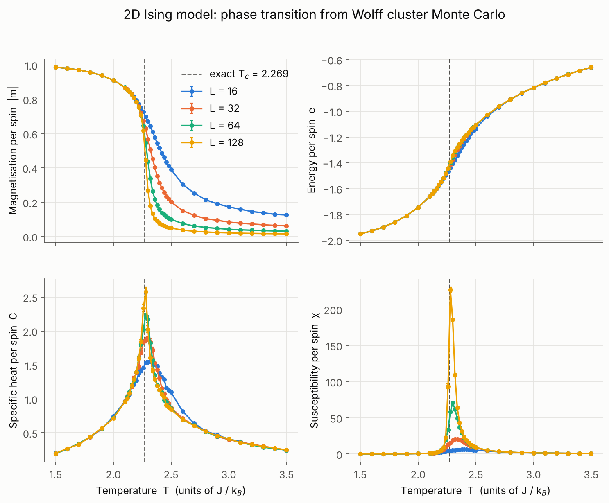
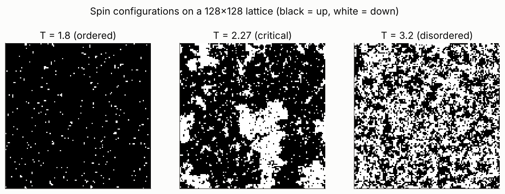
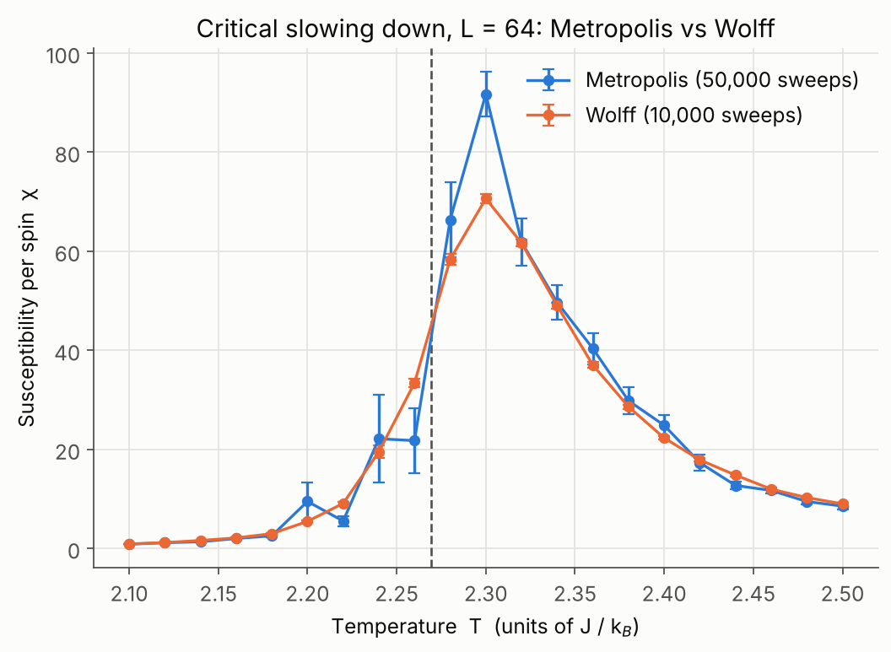
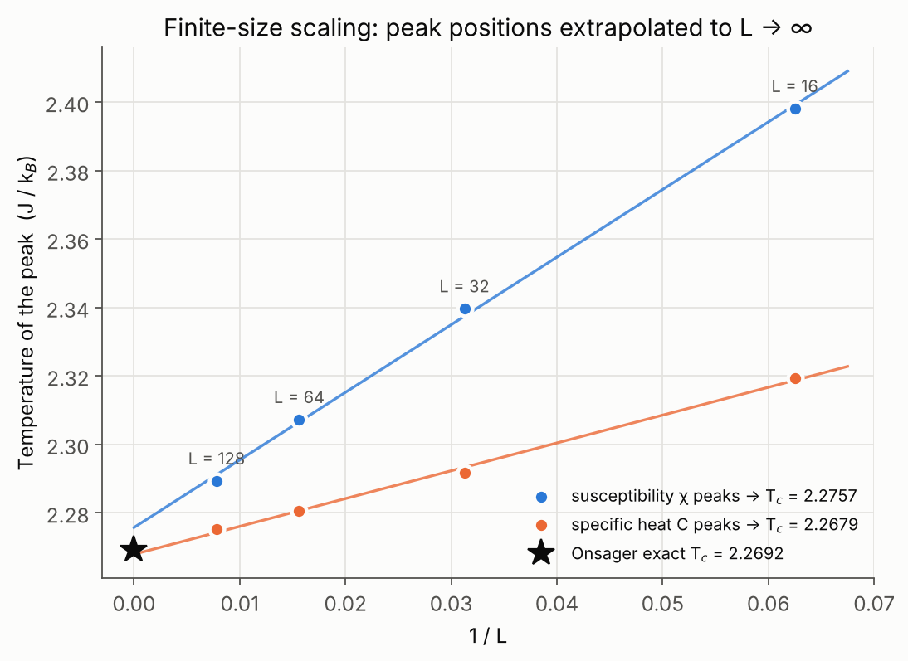

# 2D Ising Model – Monte Carlo Simulation


Monte Carlo simulation of the two-dimensional Ising model (Metropolis and Wolff cluster algorithms) that reproduces the ferromagnetic phase transition. Finite-size scaling of the specific-heat peak gives **T<sub>c</sub> = 2.2679**, within **0.06%** of Onsager's exact value **2.2692**; the susceptibility peak gives 2.2757 (0.29%).



## The physics

The Ising model is the simplest model of a magnet. Spins s<sub>i</sub> = ±1 sit on an L × L square lattice and interact with their four nearest neighbours. With coupling J = 1, no external field and k<sub>B</sub> = 1, the energy of a configuration is

$$E = -J \sum_{\langle i,j \rangle} s_i s_j$$

At low temperature, aligned neighbours lower the energy, so the spins order into a magnet. At high temperature, thermal fluctuations win and the spins are disordered. In two dimensions the transition is sharp in the infinite-lattice limit, at the temperature found exactly by Onsager (1944):

$$T_c = \frac{2}{\ln(1+\sqrt{2})} \approx 2.2692$$



## Method

Two Monte Carlo algorithms are implemented and checked against exact results:

- **Metropolis (single-spin flip):** a spin flip with energy change ΔE is accepted with probability min(1, e<sup>−ΔE/T</sup>), which satisfies detailed balance with respect to the Boltzmann distribution. One *sweep* is L² attempted flips.
- **Wolff (cluster flip):** a cluster of aligned spins is grown by adding neighbours with probability 1 − e<sup>−2J/T</sup> and flipped as a whole. Near T<sub>c</sub>, Metropolis suffers from *critical slowing down*: large correlated domains change very slowly, so samples are highly correlated. Wolff flips whole domains at once and removes most of this problem. The production results below use Wolff; one Wolff "sweep" is a fixed number of cluster flips that flips about L² spins on average.



The figure compares the susceptibility for L = 64. Even with five times more sweeps, Metropolis gives a noisy, irregular peak with large error bars, while Wolff gives a smooth peak.

**Simulation settings**

- **Lattices:** L = 16, 32, 64 and 128 with periodic boundary conditions.
- **Temperatures:** 1.5 to 3.5 in steps of 0.1, refined to steps of 0.02 between 2.10 and 2.50. Temperatures run from high to low, each starting from the previous lattice (annealing), which shortens equilibration.
- **Statistics (Wolff):** 1,000 equilibration sweeps are discarded, then 10,000 measurement sweeps per temperature.
- **Observables (per spin, N = L²):**
  - energy e = ⟨E⟩/N and magnetisation |m| = ⟨|M|⟩/N
  - specific heat C = (⟨E²⟩ − ⟨E⟩²) / (N T²)
  - susceptibility χ = (⟨M²⟩ − ⟨|M|⟩²) / (N T)
- **Error bars:** samples are correlated in Monte Carlo time, so errors come from a block jackknife (20 blocks).
- **Speed:** the update loops are compiled with [Numba](https://numba.pydata.org/); Metropolis uses precomputed acceptance probabilities (a positive ΔE can only be 4 or 8).

## Results

The specific heat and susceptibility peak near T<sub>c</sub>, and the peaks grow sharper as the lattice gets larger, as expected for a continuous phase transition.

| Lattice size L | Peak of χ | Peak of C |
| --- | --- | --- |
| 16 | 2.398 | 2.319 |
| 32 | 2.340 | 2.292 |
| 64 | 2.307 | 2.281 |
| 128 | 2.289 | 2.275 |

On a finite lattice the peaks are shifted from the true T<sub>c</sub>. Finite-size scaling theory predicts T<sub>peak</sub>(L) = T<sub>c</sub> + a·L<sup>−1/ν</sup>, with ν = 1 for the 2D Ising model. Fitting a straight line to the peak positions against 1/L for L = 16–128 and extrapolating to L → ∞ gives:

| Observable | Extrapolated T<sub>c</sub> | Deviation from exact 2.2692 |
| --- | --- | --- |
| Specific heat C | 2.2679 | 0.06% |
| Susceptibility χ | 2.2757 | 0.29% |

The statistical fit errors (0.0012 and 0.0019) are smaller than the remaining deviations, so the error is dominated by systematic effects: corrections to the simple 1/L scaling (largest for L = 16 and for χ) and locating each peak on a 0.02-wide temperature grid. Larger lattices and a finer grid near the peaks would reduce both.



## How to run

```bash
git clone https://github.com/<your-username>/ising-model-monte-carlo.git
cd ising-model-monte-carlo
pip install -e ".[dev]"

python scripts/run_sweep.py        # Wolff, L = 16–128, ~20 minutes; writes data/ising_L*.csv
python scripts/run_sweep.py --algorithm metropolis --sizes 64 --n-eq 5000 --n-meas 50000 --out data/metropolis
python scripts/make_figures.py     # writes figures/*.png and results.json
pytest                             # runs the test suite
```

For a quick test: `python scripts/run_sweep.py --sizes 16 --n-meas 2000`. Seeds are fixed, so results are reproducible.

## Project structure

```
src/ising/
    lattice.py       lattice creation, energy, magnetisation, ΔE
    updates.py       Metropolis sweep, Wolff cluster update, measurement loop (Numba)
    analysis.py      observables, jackknife errors, peak finding, finite-size extrapolation
scripts/
    run_sweep.py     temperature sweep for several lattice sizes -> CSV
    make_figures.py  figures and T_c estimate
tests/
    test_ising.py    unit and physics tests (ground state, ΔE, limits, analysis)
data/                simulation output (CSV); data/metropolis/ holds the Metropolis comparison run
figures/             plots used in this README
docs/STUDY_GUIDE.md  physics, algorithms and code explained, with practice questions
```

## Tests and CI

The test suite checks exact results (ground-state and checkerboard energies), that the ΔE used in the update equals the true energy difference, the low- and high-temperature limits and the analysis functions. Most importantly, it checks that **both algorithms reproduce the exact Boltzmann averages of a 4 × 4 lattice, computed by summing all 2<sup>16</sup> states**. This test caught a real bug during development: an early Wolff version stopped each sweep after a state-dependent number of clusters, which biased the results. GitHub Actions runs the tests on Python 3.11–3.13 for every push.

## What I learned / next steps

- Monte Carlo estimates need care with equilibration and correlated samples; naive error bars are too small.
- The choice of algorithm matters near a critical point: cluster updates beat single-spin updates by a wide margin.
- Validating against an exactly solvable case is the most reliable way to catch subtle sampling bias.
- Finite-size effects are large near T<sub>c</sub>, and finite-size scaling turns them into a precise estimate of T<sub>c</sub>.
- Next: estimate the critical exponents γ/ν and β/ν from how the peak heights and magnetisation scale with L.

## References

- L. Onsager, *Crystal Statistics. I. A Two-Dimensional Model with an Order-Disorder Transition*, Phys. Rev. 65, 117 (1944).
- U. Wolff, *Collective Monte Carlo Updating for Spin Systems*, Phys. Rev. Lett. 62, 361 (1989).
- M. E. J. Newman and G. T. Barkema, *Monte Carlo Methods in Statistical Physics*, Oxford University Press (1999).

## License

MIT
